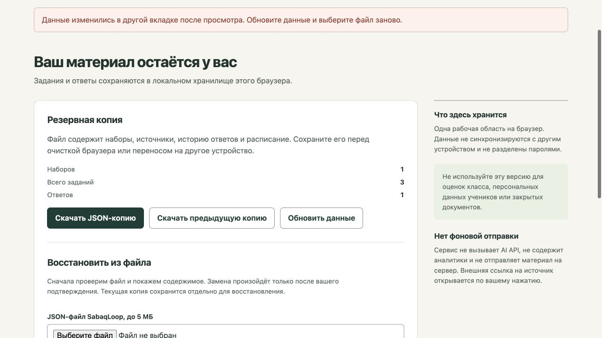

# SabaqLoop: восстановление без устаревшего подтверждения

25 октября2026. Исправлены проверка предпросмотра и обработка отказа записи.

Прежняя версия позволяла подтвердить старый файл после нового ответа другой вкладки: текущие2 попытки заменялись копией без ответов. Они оставались в recovery, поэтому безвозвратная потеря не заявляется. При отказе записи новой базы прежняя recovery-копия могла измениться, хотя восстановление не завершалось.

Теперь подтверждение сравнивает исходные сохранённые данные с текущими и отклоняет устаревшее состояние до записи. Успешная локальная правка, отмена и обновление отменяют прежний предпросмотр/незавершённое чтение файла. При отказе записи базы выполняется возврат прежней recovery-копии.

Проходят17 тестов:14 прежних и3 дополнительных. Две новые проверки упали на baseline; обычное сохранение предыдущей копии уже работало. Отказы/запреты записи моделируются в тестах, реальное исчерпание квоты браузера не заявляется.

В двух реальных тестовых вкладках старое подтверждение отклонено. Скачанные JSON совпали по всем полям рабочей области:2 попытки/версия4 и прежняя recovery неизменны. После локального добавления набора старый предпросмотр исчез; прежние попытки/снимки сохранились. Свежая явная замена и перезагрузка сохранили выбранную копию с1 заданием/0 попыток, а предыдущая копия точно совпала с прежними2 наборами/6 заданиями/2 попытками. Рабочая публичная область владельца не заменялась.

localStorage не поддерживает транзакцию двух ключей или общую блокировку вкладок. Если хранилище блокирует и компенсирующий возврат, приложение сообщает об этом отдельно; прежняя recovery тогда не гарантируется. Регулярный экспорт остаётся необходимым. Продукт остаётся локальным инструментом без защищённых аккаунтов класса и доказанных учебных результатов.

[Доказательства](restore-verification.json) · [Исходники](https://github.com/wpalish/sabaqloop)

